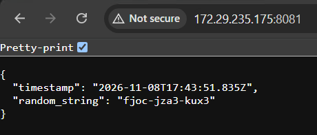

# Log output

This application was created for the University of Helsinki **DevOps with Kubernetes 2026** course.

## Description

The application generates a random string when it starts, keeps the string in memory, and prints it to standard output every five seconds together with a UTC timestamp.

It also exposes an HTTP endpoint using **FastAPI** and **Uvicorn** to retrieve the current application status.

Example log output:

```text
2026-11-08T13:35:52.423Z: ucnl-0c5b-batg
2026-11-08T13:35:57.424Z: ucnl-0c5b-batg
2026-11-08T13:36:02.424Z: ucnl-0c5b-batg
```

The random string remains the same while the application process is running, while the timestamp is updated every five seconds.

### HTTP endpoint

The application exposes the current status through:

```http
GET /
```

Example response:

```json
{
  "timestamp": "2026-11-08T13:35:52.423Z",
  "random_string": "ucnl-0c5b-batg"
}
```

The HTTP server listens on port `8787`.

## Project files

- `app.py` - application logic, logging loop, and FastAPI HTTP endpoint
- `requirements.txt` - Python dependencies (FastAPI and Uvicorn)
- `Dockerfile` - container image definition
- `k8s/deployment.yml` - Kubernetes deployment configuration
- `k8s/service.yml` - ClusterIP service exposing the application internally
- `k8s/ingress.yml` - Kubernetes Ingress configuration for external HTTP access
- `screenshots/log_output.png` - screenshot of the application accessed through Ingress

## Build and deploy

Build the container image:

```bash
docker build -t log_output:1.1 .
```

In k3d, import the image into the cluster:

```bash
k3d image import log_output:1.1 -c <cluster-name>
```

Apply the Kubernetes resources:

```bash
kubectl apply -f k8s/deployment.yml
kubectl apply -f k8s/service.yml
kubectl apply -f k8s/ingress.yml
```

## External access with Ingress

The application is exposed externally through Kubernetes Ingress using the **Traefik Ingress Controller**, which is available in the k3d cluster.

The traffic flow is:

```text
Browser
   |
   v
k3d Load Balancer (host port 8081)
   |
   v
Traefik Ingress Controller (port 80)
   |
   v
Kubernetes Ingress
   |
   v
log-output-svc (port 80)
   |
   v
Log Output Pod (port 8787)
```

The k3d cluster exposes port `80` through host port `8081`.

Access the application using:

```text
http://<cluster-ip>:8081/
```

### Application screenshot




## Exercises

- Course: DevOps with Kubernetes 2026
- Exercise 1.1 - Getting started
- Exercise 1.7 - External access with Ingress
