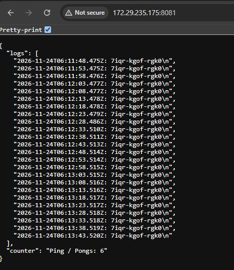

# Log output

This application was created for the University of Helsinki **DevOps with Kubernetes 2026** course.

## Description

The Log output application is split into two separate containers running inside a single Kubernetes Pod.

The containers have separate responsibilities:

1. **Generator:** Generates a random string when it starts and writes (appends) a line containing the random string and a UTC timestamp to a shared file every five seconds.
2. **Server:** Reads the shared log file and exposes its contents through an HTTP GET endpoint using **FastAPI** and **Uvicorn**.

The application uses two Kubernetes volumes for different purposes:

- **`emptyDir` (`/shared`):** Shared between the Generator and Server containers inside the same Pod. It allows them to exchange data through the filesystem. Its contents exist for the lifetime of the Pod.
- **PersistentVolumeClaim (`/data`):** Shared between the Log Output and Ping-Pong applications. It provides persistent storage that remains available when Pods are recreated, as long as the underlying storage remains available.

The PersistentVolume (PV) and PersistentVolumeClaim (PVC) are defined separately from the application manifests at the project level.


The storage architecture uses two different volume types:

- **Pod-local communication:** The `emptyDir` volume allows the Generator and Server containers to share the generated log file.
- **Persistent application data:** Both application Pods mount the same PVC at `/data`. This allows the Ping-Pong application to persist its request counter and the Log Output application to read that counter.

The PVC is bound to a PersistentVolume backed by local storage on a Kubernetes node. The PV and PVC are managed independently of the application Deployments.

The `emptyDir` volume is tied to the Pod lifecycle, whereas the persistent volume is independent of the Pod lifecycle.

### Generator

The generator creates a random string at startup. The string remains unchanged while the container is running.

Every five seconds, it appends a new line to `/shared/log.txt` containing the current UTC timestamp and the generated random string.

Example file content:

```text
2026-11-15T05:35:52.423Z: ucnl-0c5b-batg
2026-11-15T05:35:57.424Z: ucnl-0c5b-batg
2026-11-15T05:36:02.424Z: ucnl-0c5b-batg
```

### Server

The server reads the contents of `/shared/log.txt` and returns them through:

```http
GET /
```

Example response:

```json
{
  "logs": [
    "2026-11-15T05:35:52.423Z: ucnl-0c5b-batg\n",
    "2026-11-15T05:35:57.424Z: ucnl-0c5b-batg\n",
    "2026-11-15T05:36:02.424Z: ucnl-0c5b-batg\n"
  ]
}
```

The HTTP server listens on port `8787`.


## Project structure

```text
log_output/
├── README.md
├── generator/
│   ├── Dockerfile
│   └── generator.py
├── server/
│   ├── Dockerfile
│   ├── requirements.txt
│   └── server.py
├── k8s/
│   ├── deployment.yml
│   ├── service.yml
│   └── ingress.yml
└── screenshots/
    ├── log_output1.png
    └── log_output2.png
storage/
├── persistent-volume.yml
└── persistent-volume-claim.yml
```

## Build and deploy

Build the generator image:

```bash
docker build -t log_output_generator:1.0 ./generator
```

Build the server image:

```bash
docker build -t log_output_server:1.0 ./server
```

In k3d, import both images into the cluster:

```bash
k3d image import log_output_generator:1.0 log_output_server:1.0 -c <cluster-name>
```

Apply the Kubernetes resources:

```bash
kubectl apply -f k8s/deployment.yml
kubectl apply -f k8s/service.yml
kubectl apply -f k8s/ingress.yml
```

Check the Pod and container status:

```bash
kubectl get pods
kubectl describe pod <pod-name>
```

View the logs of each container independently:

```bash
kubectl logs <pod-name> -c log-output-generator
kubectl logs <pod-name> -c log-output-server
```

## External access with Ingress

The application is exposed externally through Kubernetes Ingress using the **Traefik Ingress Controller**, which is available in the k3d cluster.

The traffic flow is:

```text
Browser
   |
   v
k3d Load Balancer (host port 8081)
   |
   v
Traefik Ingress Controller (port 80)
   |
   v
Kubernetes Ingress
   |
   v
log-output-svc (port 80)
   |
   v
Log Output Pod (port 8787)
   |
   v
Server Container
```

The k3d cluster exposes port `80` through host port `8081`.

Access the application using:

```text
http://<cluster-ip>:8081/
```

### Application screenshots




## Persistent storage

The Log Output application shares persistent storage with the Ping-Pong application through a Kubernetes PersistentVolumeClaim.

The PVC is mounted at `/data` inside the Log Output Pod. This allows the application to access data written by Ping-Pong.

The shared storage contains:

- `pingpong.txt` — Stores the current Ping-Pong request counter.

The storage resources are defined separately at the project level:

- **PersistentVolume (`shared-pv`):** Represents the available storage backed by a local directory on a Kubernetes node.
- **PersistentVolumeClaim (`shared-pvc`):** Requests storage and binds to the PersistentVolume.

Both application Pods reference the same PVC. This allows them to access the same underlying data without directly depending on each other's containers or Pod lifecycle.

The persistent storage is independent of the application Pods, but because it uses local node storage, it is dependent on the availability of the node hosting the underlying directory.

## Exercises

- Course: DevOps with Kubernetes 2026
- Exercise 1.1 - Getting started
- Exercise 1.7 - External access with Ingress
- Exercise 1.10 - Even more services
- Exercise 1.11 - Persisting data