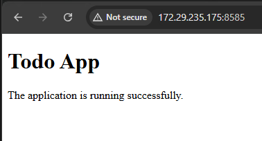

# Todo App

A simple web server built with Python and FastAPI for Exercise (1.2, 1.5) of the University of Helsinki's DevOps with Kubernetes course.

The application serves a simple HTML page at `GET /` and prints `Server started in port NNNN` when it starts. The listening port is configurable through the `PORT` environment variable and defaults to `8080`.

## Application

- **`app.py`** - Starts the FastAPI web server and exposes the `GET /` endpoint.
- **`requirements.txt`** - Lists the Python dependencies.
- **`Dockerfile`** - Builds the application image.
- **`k8s/deployment.yml`** - Defines the Kubernetes Deployment.

The root endpoint (`GET /`) returns an HTML page confirming that the Todo application is running.

## Build the Docker image

From the repository root:

```bash
docker build -t todo-app:1.1 ./todo_app
```

The Dockerfile installs the Python dependencies using the configured internal PyPI repository.

## Deploy to Kubernetes

Import the image into your k3d cluster. Replace `YOUR_CLUSTER_NAME` with your cluster name:

```bash
k3d image import todo-app:1.1 -c YOUR_CLUSTER_NAME
```

Apply the Kubernetes Deployment:

```bash
kubectl apply -f todo_app/k8s/deployment.yml
```


## Verify the application

Check the application logs:

```bash
kubectl logs deployment/todo-app
```

Expected startup message:

```text
Server started in port 8585
```

The Deployment sets `PORT=8585`, so the application listens on port `8585` inside the container.

## Access the application using port-forwarding

Forward local host port `8585` to port `8585` in the Kubernetes Deployment:

```bash
kubectl port-forward --address 0.0.0.0 deployment/todo-app 8585:8585
```

Keep this command running while accessing the application. Open the following URL in your browser:

<http://localhost:8585/>

The browser request reaches the application through `kubectl port-forward`.

### Screenshot



## Change the listening port

The application reads the `PORT` environment variable at startup. To change the port, update the `PORT` value and `containerPort` in `todo_app/k8s/deployment.yml` to the same port, then apply the updated Deployment:

```bash
kubectl apply -f todo_app/k8s/deployment.yml
kubectl rollout status deployment/todo-app
```

Update the port-forward command accordingly if the container port changes.

No image rebuild is needed to change the listening port because it is configured through an environment variable.
