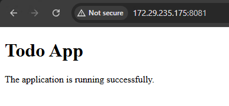

# Todo App

A simple web server built with Python and FastAPI for the University of Helsinki's **DevOps with Kubernetes 2026** course.

## Description

The application serves a simple HTML page at `GET /` and prints `Server started in port NNNN` when it starts.

The listening port is configurable through the `PORT` environment variable and defaults to `8080`.

The application is deployed to Kubernetes and exposed externally using **Ingress** and the **Traefik Ingress Controller**.

## Application

- `app.py` - Starts the FastAPI web server and exposes the `GET /` endpoint.
- `requirements.txt` - Lists the Python dependencies.
- `Dockerfile` - Builds the application image.
- `k8s/deployment.yml` - Defines the Kubernetes Deployment.
- `k8s/service.yml` - Defines the internal ClusterIP Service.
- `k8s/ingress.yml` - Defines the Ingress routing rules.

The root endpoint (`GET /`) returns an HTML page confirming that the Todo application is running.

## Build the Docker image

From the repository root:

```bash
docker build -t todo-app:1.1 ./todo_app
```

The Dockerfile installs the Python dependencies using the configured internal PyPI repository.

## Deploy to Kubernetes

Import the image into your k3d cluster. Replace `YOUR_CLUSTER_NAME` with your cluster name:

```bash
k3d image import todo-app:1.1 -c YOUR_CLUSTER_NAME
```

Apply the Kubernetes resources:

```bash
kubectl apply -f todo_app/k8s/deployment.yml
kubectl apply -f todo_app/k8s/service.yml
kubectl apply -f todo_app/k8s/ingress.yml
```

## Kubernetes networking

The application is exposed externally through an Ingress resource managed by the Traefik Ingress Controller available in the k3d cluster.

The application uses the following networking configuration:

| Component | Type | Port |
|---|---|---:|
| Container | FastAPI / Uvicorn | 8585 |
| Service | ClusterIP | 85 |
| Service target port | Container | 8585 |
| Ingress Controller | Traefik HTTP entrypoint | 80 |
| k3d host port | External access | 8081 |

The traffic flow is:

```text
Browser
   |
   v
k3d Load Balancer (host port 8081)
   |
   v
Traefik Ingress Controller (port 80)
   |
   v
Todo App Ingress
   |
   v
todo-app-svc (port 85)
   |
   v
Todo App Pod (port 8585)
```

The Ingress does not specify a hostname, allowing requests to be routed without requiring a custom hostname or hosts-file entry.

The k3d cluster maps host port `8081` to port `80` on its load balancer.

## Access the application

Open the following URL in your browser:

```text
http://localhost:8081/
```

If accessing the application from another machine, use the IP address of the host running k3d:

```text
http://<host-ip>:8081/
```

The browser request is routed through Traefik and the Kubernetes Ingress to the Todo App Service and Pod.


## Change the listening port

The application reads the `PORT` environment variable at startup.

To change the port, update the `PORT` environment variable and `containerPort` in `k8s/deployment.yml`, and update the Service `targetPort` in `k8s/service.yml` accordingly.

No image rebuild is needed to change the listening port because it is configured through an environment variable.

## Screenshot



## Exercises

- Course: DevOps with Kubernetes 2026
- Exercise 1.2
- Exercise 1.4
- Exercise 1.5
- Exercise 1.6
- Exercise 1.8
